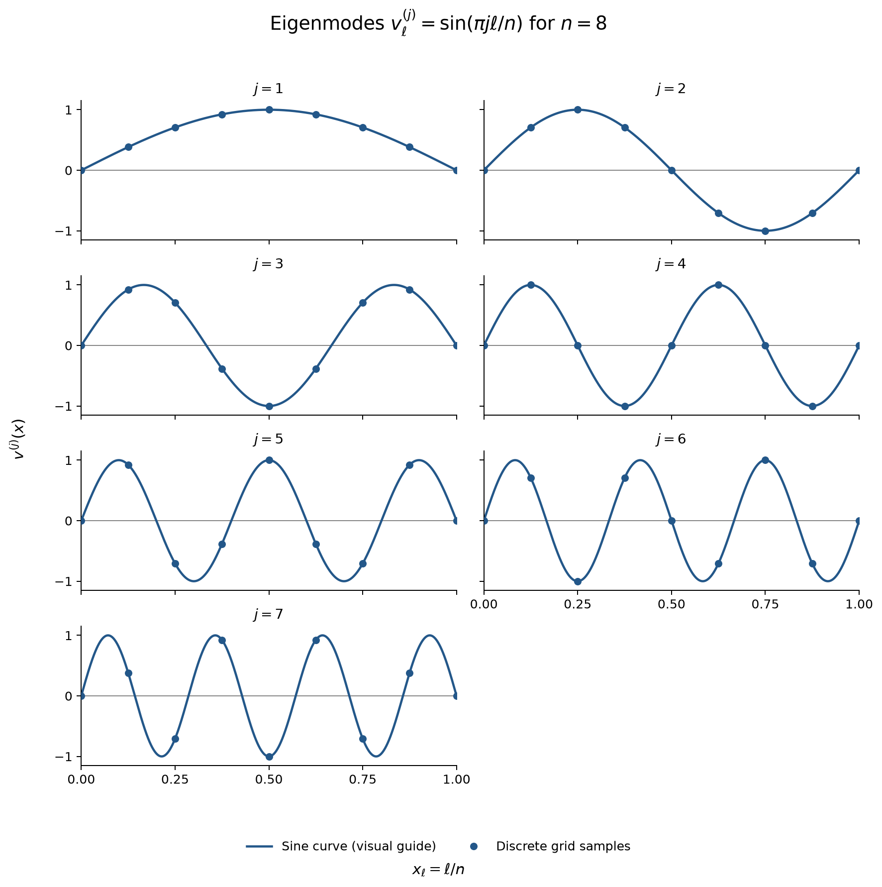
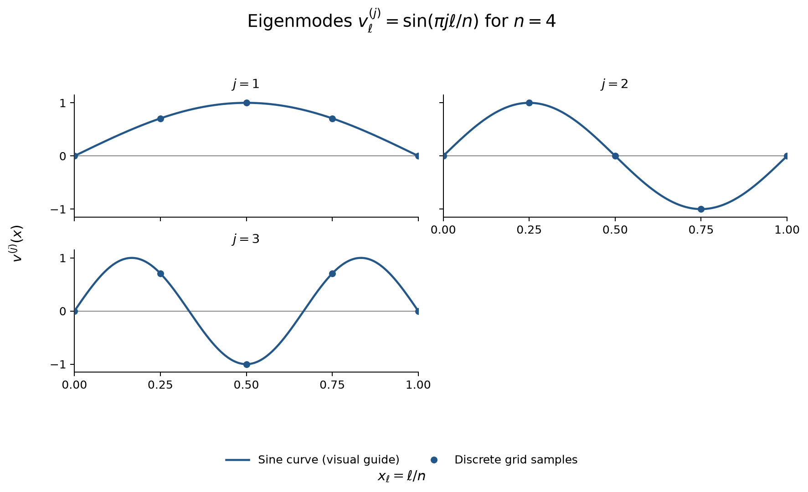
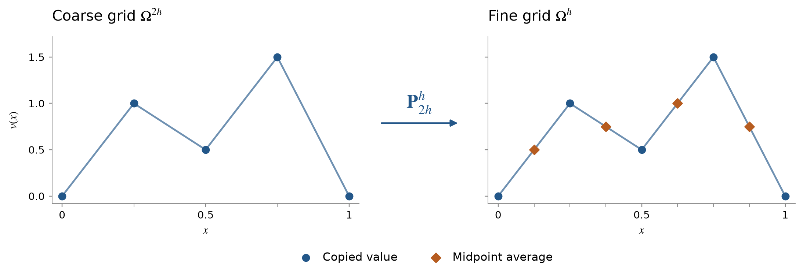
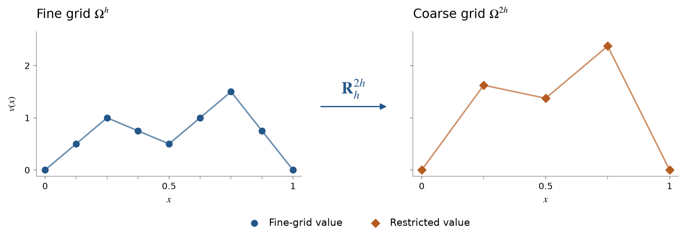
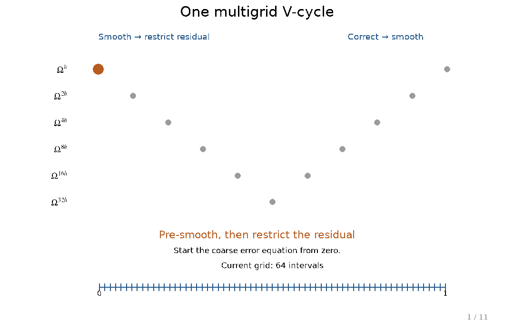

<!-- Draft outline: replace these notes with your own prose as you build the post. -->

In [Part 1](../2026-07-26-demystifying-multigrid/index.qmd), we saw that weighted Jacobi quickly damps oscillatory error but reduces smooth error very slowly. In this post, we will explore how coarse grids help address the error that relaxation leaves behind.

## Recap and Motivation

<!-- Briefly recall the 1D Poisson problem, the grid notation, and the smoothing result from Part 1. -->

Let us recall the 1D Poisson problem we saw in Part 1:

$$\begin{split}
-u''(x)  &= f(x),\quad 0<x<1\\
u(0) &= u(1) = 0
\end{split}$$

Take $n$ equal intervals, with $h=1/n$ and interior nodes $x_\ell=\ell h$ for $\ell=1,\ldots,n-1$. The central difference method gives the discrete system:
$$
\frac{1}{h^2}\begin{bmatrix}
2 & -1 & & & & \\
-1 & 2 & -1& & & \\
 & -1 & 2 & -1 & & \\
  &  & \ddots & \ddots & \ddots & \\
  &  & & \ddots & \ddots &  -1\\
 &  & &  & -1 &  2\\
\end{bmatrix}\mathbf{v} = \mathbf{f},
$$

with:

$$\mathbf{T} = \begin{bmatrix}
2 & -1 & & & & \\
-1 & 2 & -1& & & \\
 & -1 & 2 & -1 & & \\
  &  & \ddots & \ddots & \ddots & \\
  &  & & \ddots & \ddots &  -1\\
 &  & &  & -1 &  2\\
\end{bmatrix},\qquad \mathbf{A}_h = \frac{1}{h^2}\mathbf{T}.$$

Let $\mathbf{u}_h^*$ be the exact solution of this discrete system and $\mathbf{v}_h^k$ its current iterative approximation. Define the algebraic error by $\mathbf{e}^k=\mathbf{u}_h^*-\mathbf{v}_h^k$; this is distinct from the error caused by discretizing the PDE.

Also recall that, for a consistent linear stationary iterative method, we can represent the error after $k$ iterations
as:
$$
\mathbf{e}^k = \mathbf{G}^k\mathbf{e}^0
$$

where $\mathbf{G}\in\mathbb{R}^{m\times m}$ is the error-propagation matrix and $m=n-1$. **If $\mathbf{G}$ is diagonalizable**, we can expand $\mathbf{e}^0=\sum_{j=1}^m\alpha_j\boldsymbol{\varphi}_j$ in its eigenvector basis and write:

$$
\mathbf{e}^k = \sum_{j=1}^m \alpha_j (\lambda_j)^k \mathbf{\varphi}_j.
$$

This assumption holds for weighted Jacobi on our 1-D Poisson problem: its error-propagation matrix is symmetric. It does not hold for every stationary iteration.

The question that remains open from last time is: how do we remove the components of the error associated
with eigenvalues for which $|\lambda_j|\approx 1$—that is, the parts of the error that decay slowly?

## Using Smoothing Effects

To address the low-frequency components of the error, we can use a "coarser" grid. A wave that is smooth relative to the fine-grid spacing varies more rapidly relative to the coarse-grid spacing. No new frequency information is created: we sample the same wave at fewer points. Here, coarsening means increasing the mesh spacing and reducing the number of interior unknowns.

But this sounds counterintuitive at first. Intuitively, you might assume that a coarser grid provides less usable detail—like watching a movie on a 1970s box TV instead of a modern IMAX screen. However, consider a broad, gentle slope spanning thousands of fine-grid pixels. To a local smoother inspecting adjacent pixels on the IMAX screen, that slope looks nearly flat, so the smoother barely adjusts it.

When we represent that same smooth error on a coarse grid, the spatial distance between grid points increases. Its physical shape does not change, but its variation from one grid point to the next becomes more pronounced. Some modes that relaxation handles poorly on the fine grid can therefore be reduced more effectively on a coarser grid. The smoothest modes may still need further coarsening. This is how I got myself to understand this nuanced idea, but an actual example may make it clearer.

Let us again consider the matrix $\mathbf{T}$. First, we will take $n = 8$, giving us the following frequencies/modes:

With the convention from Part 1, $n=8$ means eight grid intervals and seven interior unknowns. The eigenmodes are $v_\ell^{(j)}=\sin(\pi j\ell/8)$ for $j=1,\ldots,7$.

{#fig-eigenmodes-n8 fig-alt="Seven panels of sine curves sampled on a grid with spacing one eighth. Modes one through seven oscillate increasingly rapidly."}

Now consider $n=4$: the grid spacing is $h=1/4$, and there are three interior unknowns. The corresponding eigenmodes are $v_\ell^{(j)}=\sin(\pi j\ell/4)$ for $j=1,2,3$.

{#fig-eigenmodes-n4 fig-alt="Three panels of sine curves sampled on a grid with spacing one quarter. Modes one through three oscillate increasingly rapidly."}

Of course, the plots look the same, but our evaluation points become fewer and farther apart. With this new discretization,
$j=1$ remains a smooth mode, while modes $j=2$ and $j=3$ now become higher-frequency modes. But... why?


## Why a Coarser Grid Helps

Let us consider the $j=2$ case from the previous example. The fine grid has spacing $h=1/8$ and $n=8$ intervals; the coarse grid has spacing $H=2h=1/4$ and $N=n/2=4$ intervals. On the fine grid, this mode has components

$$
v_{h,\ell}^{(2)}=\sin\left(\frac{2\pi\ell}{8}\right).
$$

Its dimensionless angular frequency is $\theta_h=\pi j/n=\pi/4$, so $j/n=1/4$ is its frequency relative to the grid's Nyquist limit $\theta=\pi$. This measures oscillation relative to the mesh spacing, not a fraction of the grid's eigenmodes.

To isolate the sampling effect, retain every second fine-grid value (a transfer called **injection**). Coarse index $\ell$ corresponds to fine index $2\ell$, giving

$$
v_{H,\ell}^{(2)}=v_{h,2\ell}^{(2)}
=\sin\left(\frac{2\pi(2\ell)}{8}\right)
=\sin\left(\frac{2\pi\ell}{4}\right),\qquad \ell=0,\ldots,N.
$$

The normalized frequency is now $j/N=1/2$, at the start of the coarse grid's high-frequency band. The physical wave has not changed; its angular frequency per grid step has doubled.

For weighted Jacobi with $\omega=2/3$, the amplification factor for mode $j$ on a grid with $n$ intervals is

$$
\gamma_j^{(n)}=1-\frac{4}{3}\sin^2\left(\frac{\pi j}{2n}\right).
$$

Thus $\gamma_2^{(8)}\approx0.805$, whereas $\gamma_2^{(4)}=1/3$. One sweep reduces this mode's amplitude much more on the coarse grid. More generally, $|\gamma_j^{(n)}|\leq1/3$ for $n/2\leq j\leq n-1$. This smoothing statement is specific to the weighted-Jacobi choice above; ordinary Jacobi does not uniformly damp the high-frequency modes.

In the actual multigrid algorithm, we restrict the **residual** and solve a coarse error equation. Injection here illustrates the frequency change; the weighted restriction introduced below also changes the mode amplitudes.

## What Happens to Fine High Frequencies?

What if we consider $j=5$? This mode is already high-frequency on the fine grid. Can its coarse samples distinguish it from every lower-frequency mode? (Try to answer this yourself.)

Answer in 3...2...1...

*NO!* The coarse grid has only three independent interior modes. The fine-grid $j=5$ mode becomes indistinguishable, up to a sign, from the coarse-grid $j=3$ mode. For $N=4$, its samples are

$$
v_{h,2\ell}^{(5)}=\sin\left(\frac{5\pi\ell}{N}\right).
$$

Using the sine difference identity,

$$
\begin{aligned}
\sin\left(\frac{(2N-5)\pi\ell}{N}\right)
&=\sin\left(2\pi\ell-\frac{5\pi\ell}{N}\right)\\
&=\sin(2\pi\ell)\cos\left(\frac{5\pi\ell}{N}\right)
-\cos(2\pi\ell)\sin\left(\frac{5\pi\ell}{N}\right)\\
&=-\sin\left(\frac{5\pi\ell}{N}\right).
\end{aligned}
$$

Hence $v_{h,2\ell}^{(5)}=-v_{H,\ell}^{(3)}$. This is **aliasing**: different fine-grid modes give the same coarse samples up to a scalar factor.

More generally, for $N<j\leq n-1$ and $n=2N$,

$$
v_{h,2\ell}^{(j)}=-v_{H,\ell}^{(n-j)}.
$$

The boundary case $j=N=n/2$ is different: all its coarse samples are $\sin(\pi\ell)=0$. The coarse grid therefore cannot represent every fine-grid error component independently. Notice also that an aliased mode need not be low-frequency on the coarse grid: in our example, $j=3$ is its highest mode.

This motivates the main idea behind multigrid methods:

1. Use a few weighted-Jacobi sweeps on $\Omega^h$ to reduce high-frequency error before transferring information to a coarser grid.

2. Restrict the residual to $\Omega^{2h}$ and approximately solve the coarse error equation. Prolongate that correction to reduce error that was smooth on the fine grid.

3. Apply the same idea recursively on $\Omega^{4h},\Omega^{8h},\ldots$, solving directly on the coarsest grid. Return through the levels with corrections and post-smoothing, then repeat cycles until the desired tolerance is reached. A finite number of sweeps does not generally eliminate all error exactly.


## The Four Corners of Multigrid 

::: {.callout-note appearance="simple" icon="false" title="A note on the reference"}

The framework below draws on @olson2015multigrid, particularly the discussion of smoothing, grid-transfer operators, and Galerkin coarse-grid correction. The [author's manuscript](https://lukeo.cs.illinois.edu/files/2015_Ol_encmg.pdf) is freely available. I use different notation here: $n$ counts grid intervals, and $h_0$ denotes the coarsest mesh spacing.

:::

### Hierarchy of Grids

Let us assume that we have a hierarchy of grids. We start from the finest grid with a mesh size of $h$. 
Then, the grid on the next level will have a mesh size of $2h$, the one after that $4h$, etc. For the coarsest grid,
we denote it by $h_0 = 2^{L-1}h$ (where $L$ is the number of levels we have). The physical grid at the finest
level will be denoted as $\Omega^h$ and $\Omega^{h_0}$ is the grid at the coarsest level. 

We choose nested grids so that each coarse node is a fine node. For the examples here, $n$ is a power of two and the coarsest grid has two intervals, leaving one interior unknown.

![A four-level hierarchy on $[0,1]$ with $h=1/16$ and $h_0=8h=1/2$. Each notch marks a grid point. Each coarser grid retains every second point of the preceding grid, doubling the mesh spacing.](grid-hierarchy.png){#fig-grid-hierarchy fig-alt="Four aligned one-dimensional grids labeled Omega h, Omega 2h, Omega 4h, and Omega h-zero equals Omega 8h. From finest to coarsest, they have 16, 8, 4, and 2 equal intervals, with notches at every grid point and labeled spacing brackets."}

### Interpolation/Prolongation

We have spoken much about these different grid discretizations, but we have yet to discuss how we actually TRANSFER
between these discretizations. First, we will discuss the operator that brings us from a coarse grid to the finer grid
at the next level up. This is called the **interpolation/prolongation operator**. It maps values defined on the coarse grid to values on the fine grid. For $n=2N$ intervals and homogeneous Dirichlet boundary values, its action on the interior vectors is:

$$\mathbf{P}_{2h}^h: \mathbb{R}^{N-1} \rightarrow \mathbb{R}^{n-1}.$$

Then, for quantities $\mathbf{x}_h$ and $\mathbf{x}_{2h}$ defined on grids $\Omega^h$ and $\Omega^{2h}$ respectively, 
we can define the explicit prolongation as:

$$\mathbf{P}_{2h}^h\mathbf{x}_{2h} = \mathbf{x}_h$$

Designing prolongation matrices is a major research subfield of multigrid methods (to be discussed in later posts). 
For now, though, let us consider a simple example: linear interpolation. 

At the even points on the fine grid, we copy the coarse values: $v_{h,2\ell}=v_{2h,\ell}$ for $\ell=0,\ldots,N$. At the odd points, we interpolate between adjacent coarse values. These are estimates of the missing values, not a recovery of arbitrary fine-grid data. Linear interpolation gives:

$$v_{h,2\ell+1} = \frac{1}{2}(v_{2h,\ell} + v_{2h,\ell+1}),\qquad \ell=0,\ldots,N-1.$$

With $v_{2h,0}=v_{2h,N}=0$, the matrix acting on the interior values for $N=4$ and $n=8$ is:

$$\mathbf{P}_{2h}^h\mathbf{v}_{2h} = \frac{1}{2}\begin{bmatrix}
1 & & \\
2 & & \\
1 & 1 & \\
  & 2 & \\
  & 1 & 1\\
  & & 2\\
  & & 1
\end{bmatrix}\begin{bmatrix}
\mathbf{v}_{2h,1}\\
\mathbf{v}_{2h,2}\\
\mathbf{v}_{2h,3}
\end{bmatrix} = \begin{bmatrix}
\mathbf{v}_{h,1}\\
\mathbf{v}_{h,2}\\
\vdots\\
\mathbf{v}_{h,7}
\end{bmatrix}$$


{#fig-prolongation fig-alt="Coarse grid values 0, 1, 0.5, 1.5, 0 are prolonged from four intervals to eight. An arrow labeled P from 2h to h leads to the fine grid, where blue circles retain those values and orange diamonds add midpoint values 0.5, 0.75, 1, and 0.75."}

### Restriction

The operator that transfers fine-grid values to the coarse grid is called **restriction**. For the same interior vector spaces, it has the mapping:

$$\mathbf{R}_h^{2h}: \mathbb{R}^{n-1} \rightarrow \mathbb{R}^{N-1}.$$

More specifically, we can write the restriction as:

$$\mathbf{R}_h^{2h}\mathbf{x}_h =\mathbf{x}_{2h}$$

As with prolongation, there are many restriction operators. Here we choose **transpose restriction**, $\mathbf{R}=\mathbf{P}^{\mathsf{T}}$, which is commonly paired with the Galerkin coarse operator $\mathbf{A}_{2h}=\mathbf{P}^{\mathsf{T}}\mathbf{A}_h\mathbf{P}$. Restriction alone is not the Galerkin projection. Using our prolongation matrix gives:

$$\mathbf{R}_h^{2h}\mathbf{v}_h = \frac{1}{2}\begin{bmatrix}
1 & 2 & 1 &   &   &  & \\
  &   & 1 & 2 & 1 &  & \\
  &   &   &   & 1 & 2 & 1
\end{bmatrix}\begin{bmatrix}
\mathbf{v}_{h,1}\\
\mathbf{v}_{h,2}\\
\vdots\\
\mathbf{v}_{h,7}
\end{bmatrix} = \begin{bmatrix}
\mathbf{v}_{2h,1}\\
\mathbf{v}_{2h,2}\\
\mathbf{v}_{2h,3}
\end{bmatrix}$$


{#fig-restriction fig-alt="Fine-grid values 0, 0.5, 1, 0.75, 0.5, 1, 1.5, 0.75, 0 on the left are mapped by R from h to 2h to coarse-grid values 0, 1.625, 1.375, 2.375, 0 on the right."}

The weights here are $(1/2,1,1/2)$, a weighted **sum**. The common 1-D **full-weighting** choice instead uses $\mathbf{R}_{\mathrm{FW}}=\tfrac12\mathbf{P}^{\mathsf{T}}$, with weights $(1/4,1/2,1/4)$. We use transpose restriction throughout this post, including the code. With either convention, form both the coarse matrix $\mathbf{A}_{2h}=\mathbf{R}\mathbf{A}_h\mathbf{P}$ and the coarse right-hand side $\mathbf{r}_{2h}=\mathbf{R}\mathbf{r}_h$ consistently. Multiplying both by the same nonzero scalar leaves the exact coarse correction unchanged.

### Iterative Methods and the Two-Grid Scheme

We have already discussed iterative methods a bit, but some additional context is needed to better understand how they
fit into the entire "multigrid" story. On the finest grid we solve for the solution; on coarser grids we approximately solve error equations. You may or may not know, from numerical linear algebra, that one way we can
find crude approximations to the solutions of linear systems is through iterative methods (as was discussed a bit in Part 1).
Let's say, for example, we had a simple **two-grid** scheme. That is, we have a single fine grid and a single 
coarse grid. Then, the algorithm would proceed as follows:

With our error convention, $\mathbf{e}_h=\mathbf{u}_h^*-\mathbf{v}_h$ and $\mathbf{r}_h=\mathbf{f}_h-\mathbf{A}_h\mathbf{v}_h$ satisfy $\mathbf{A}_h\mathbf{e}_h=\mathbf{r}_h$. This explains why we solve for a coarse error correction and **add** its prolongation to the current approximation.

1. Iterate on the fine-level problem $\mathbf{A}_h \mathbf{v} = \mathbf{f}_h$ to reach $\mathbf{v}_h$ via 
a few iterations of an iterative method like weighted Jacobi or Gauss-Seidel.

2. Restrict the residual $\mathbf{r}_h = \mathbf{f}_h - \mathbf{A}_h\mathbf{v}_h$ to the coarse grid by applying
a designated restriction operator:

   $$\mathbf{r}_{2h} = \mathbf{R}_h^{2h}\mathbf{r}_h$$

3. Solve the coarse approximation to the error equation, with homogeneous boundary values:

   $$\mathbf{A}_{2h}\mathbf{e}_{2h} = \mathbf{r}_{2h}$$


4. Prolongate the coarse correction and update the fine approximation:

   $$\mathbf{v}_h\leftarrow\mathbf{v}_h+\mathbf{P}_{2h}^h\mathbf{e}_{2h}.$$

5. Apply a few more smoothing sweeps to $\mathbf{A}_h\mathbf{v}_h=\mathbf{f}_h$, starting from the corrected $\mathbf{v}_h$.

*Note*: You may be wondering: how do we find $\mathbf{A}_{2h}$? It turns out, we RAP! Not in the Kendrick
Lamar way, but the "let's restrict and prolongate our fine-level discretization" way. More specifically, we have:

$$\mathbf{A}_{2h} = \mathbf{R}_h^{2h}\mathbf{A}_h \mathbf{P}_{2h}^h.$$

For our fine-grid finite-difference matrix and linear interpolation, the choice $\mathbf{R}=\mathbf{P}^{\mathsf{T}}$ gives $\mathbf{A}_{2h}=2\widetilde{\mathbf{A}}_{2h}$, where $\widetilde{\mathbf{A}}_{2h}$ is obtained by directly discretizing on spacing $2h$. Full weighting would give $\widetilde{\mathbf{A}}_{2h}$ itself. This scaling does not change weighted-Jacobi's error-propagation matrix, since its diagonal scales by the same factor.

Here $\mathbf{A}_h$ is symmetric positive definite and $\mathbf{P}$ has full column rank, so $\mathbf{P}^{\mathsf{T}}\mathbf{A}_h\mathbf{P}$ is invertible. For $\mathbf{R}=\mathbf{P}^{\mathsf{T}}$ and an exact coarse solve, the fine-space operator $\mathbf{Q}=\mathbf{P}(\mathbf{P}^{\mathsf{T}}\mathbf{A}_h\mathbf{P})^{-1}\mathbf{P}^{\mathsf{T}}\mathbf{A}_h$ is the Galerkin projection onto the range of $\mathbf{P}$, orthogonal in the $\mathbf{A}_h$ inner product. The error after correction is $(\mathbf{I}-\mathbf{Q})\mathbf{e}_h$. This precisely removes errors in that coarse space, but not arbitrary fine-grid errors.

## Multigrid Scheme
A convergent two-grid method can reach the desired algebraic accuracy, but its coarse solve may still be expensive on a large problem. Multigrid addresses that cost by approximately solving the coarse error equation with another two-grid scheme, and repeating this recursively until the coarsest problem is small. Hence **multigrid** (finally)!
One way to organize this recursion is a **V-cycle**: visit each coarser grid once, then return through the finer grids, correcting and smoothing along the way.

<!-- Algorithm formatting: ::: opens/closes the callout; 1., 2., ... make the steps.
     Use $...$ for inline math. Indent continuation paragraphs by three spaces
     to keep them inside a numbered step. -->

::: {#v-cycle-algorithm .callout-note appearance="simple" icon="false" title="Algorithm: one multigrid V-cycle"}

**Input:** current mesh spacing $h$, right-hand side $\mathbf{f}_h$, and initial approximation $\mathbf{v}_h$.

**Setup:** choose smoothing counts $\nu_1,\nu_2$ and construct the grid hierarchy, transfer operators, and coarse matrices $\mathbf{A}_{2h}=\mathbf{R}_h^{2h}\mathbf{A}_h\mathbf{P}_{2h}^h$ in advance. Write this routine as $\operatorname{VCycle}(h,\mathbf{f}_h,\mathbf{v}_h)$.

1. **Coarsest grid:** if $h=h_0$, solve $\mathbf{A}_h\mathbf{v}_h=\mathbf{f}_h$ directly and **return** $\mathbf{v}_h$.

2. **Pre-smooth:** apply $\nu_1$ relaxation sweeps to $\mathbf{A}_h\mathbf{v}_h=\mathbf{f}_h$, starting from the current $\mathbf{v}_h$.

3. **Compute and restrict the residual:**

   $$
   \mathbf{r}_h=\mathbf{f}_h-\mathbf{A}_h\mathbf{v}_h,
   \qquad
   \mathbf{r}_{2h}=\mathbf{R}_h^{2h}\mathbf{r}_h.
   $$

4. **Recurse on the coarse error equation**, starting from zero:

   $$
   \mathbf{e}_{2h}\leftarrow\operatorname{VCycle}(2h,\mathbf{r}_{2h},\mathbf{0}).
   $$

5. **Prolongate and correct:**

   $$
   \mathbf{v}_h\leftarrow\mathbf{v}_h+\mathbf{P}_{2h}^h\mathbf{e}_{2h}.
   $$

6. **Post-smooth:** apply $\nu_2$ relaxation sweeps to $\mathbf{A}_h\mathbf{v}_h=\mathbf{f}_h$, starting from the corrected approximation.

7. **Return** the updated $\mathbf{v}_h$.

:::

To solve the original problem, repeat V-cycles on the finest grid until $\|\mathbf{f}_h-\mathbf{A}_h\mathbf{v}_h\|_2\leq\max(\varepsilon_{\mathrm{abs}},\varepsilon_{\mathrm{rel}}\|\mathbf{f}_h\|_2)$ or a chosen maximum number of cycles is reached. The coarse calls solve for an error correction, so they use homogeneous boundary conditions for this Dirichlet problem.

## Watching a V-Cycle

The animation follows one cycle through six levels, from $h=1/64$ to $h_0=1/2$. On the way down, we smooth and restrict the residual. On the way up, we prolongate the error correction and smooth again. The highlighted node marks the current stage; the notches show its grid. This is an illustration of the traversal, not a plot of error magnitude.

{#fig-v-cycle fig-alt="Animated V-shaped path through grids with 64, 32, 16, 8, 4, and 2 intervals. A highlight descends during pre-smoothing and residual restriction, pauses at the coarse solve, and ascends during prolongation, correction, and post-smoothing."}

## Computational Experiment

For a concrete version of our Poisson problem, take

$$
-u''(x)=\pi^2\sin(\pi x),\qquad u(0)=u(1)=0,
$$

whose exact solution is $u(x)=\sin(\pi x)$. The code below starts from zero on a grid with $n=64$ intervals and applies V-cycles until the relative residual is below $10^{-10}$. Each cycle uses two weighted-Jacobi sweeps before and after the coarse correction, with $\omega=2/3$.

```{python}
#| label: fig-v-cycle-solution
#| echo: true
#| code-fold: false
#| fig-cap: "The multigrid approximation and exact solution, alongside the relative residual after each V-cycle."
#| fig-width: 9
#| fig-height: 3.4

import numpy as np
import matplotlib.pyplot as plt


def hierarchy(n):
    """Interior Dirichlet matrices and linear transfer operators."""
    if n < 2 or n & (n - 1):
        raise ValueError("n must be a power of two, at least 2")
    A = n**2 * (2 * np.eye(n - 1)
                 - np.eye(n - 1, k=1) - np.eye(n - 1, k=-1))
    matrices, transfers = [A], []
    while n > 2:
        P = np.zeros((n - 1, n // 2 - 1))
        for col in range(P.shape[1]):
            P[2 * col:2 * col + 3, col] = [0.5, 1, 0.5]
        R = P.T
        matrices.append(R @ matrices[-1] @ P)
        transfers.append(P)
        n //= 2
    return matrices, transfers


def smooth(A, b, v, sweeps=2, omega=2/3):
    for _ in range(sweeps):
        v = v + omega * (b - A @ v) / np.diag(A)
    return v


def v_cycle(matrices, transfers, level, b, v):
    A = matrices[level]
    if level == len(matrices) - 1:
        return np.linalg.solve(A, b)
    v = smooth(A, b, v)
    P = transfers[level]
    coarse_rhs = P.T @ (b - A @ v)
    coarse_error = v_cycle(matrices, transfers, level + 1,
                           coarse_rhs, np.zeros_like(coarse_rhs))
    v = v + P @ coarse_error
    return smooth(A, b, v)


n = 64
x = np.linspace(0, 1, n + 1)
b = np.pi**2 * np.sin(np.pi * x[1:-1])
matrices, transfers = hierarchy(n)
A = matrices[0]
v = np.zeros(n - 1)
relative_residuals = [np.linalg.norm(b - A @ v) / np.linalg.norm(b)]

for cycle in range(50):
    v = v_cycle(matrices, transfers, 0, b, v)
    relative_residuals.append(np.linalg.norm(b - A @ v) / np.linalg.norm(b))
    if relative_residuals[-1] < 1e-10:
        break
else:
    raise RuntimeError("V-cycles did not reach the residual tolerance")

# Check the iterative result against a direct solve of the same discrete system.
np.testing.assert_allclose(v, np.linalg.solve(A, b), rtol=1e-9, atol=1e-11)
print(f"V-cycles: {len(relative_residuals) - 1}")
print(f"Final relative residual: {relative_residuals[-1]:.2e}")
print(f"Maximum error against sin(pi*x): {np.max(np.abs(v - np.sin(np.pi*x[1:-1]))):.2e}")

fig, axes = plt.subplots(1, 2, figsize=(9, 3.4))
xx = np.linspace(0, 1, 500)
axes[0].plot(xx, np.sin(np.pi * xx), color="#8a8a8a", label="Exact solution")
axes[0].plot(x, np.r_[0, v, 0], ".", color="#235789", label="Multigrid")
axes[0].set(xlabel="x", ylabel="u(x)")
axes[0].legend(frameon=False)
axes[1].semilogy(range(len(relative_residuals)), relative_residuals,
                 "o-", color="#235789", markersize=4)
axes[1].set(xlabel="Completed V-cycles", ylabel="Relative residual")
for ax in axes:
    ax.spines[["top", "right"]].set_visible(False)
    ax.set_facecolor("none")
fig.patch.set_alpha(0)
plt.rcParams["savefig.transparent"] = True
fig.tight_layout()
plt.show()
```

The residual measures how well we solve the **discrete** system. Its convergence does not remove the finite-difference discretization error, which is why the error against $\sin(\pi x)$ remains larger. This compact example uses dense matrices for readability; a large multigrid solver would use sparse matrices or stencil operations.


## Closing Thoughts

Congrats! Now you can brag to your friends and family that you know what all the kids are talking about: multigrid
methods. Still, this short series was just a primer on this subfield of numerical analysis, and there is much
left unsaid about more "sophisticated" versions of this idea. However, they all rest on the same principles
we discussed in these two posts. In future posts, I hope to delve deeper into multigrid and even talk about
"neural" multigrid methods (one of my primary research interests). 

## References

::: {#refs}
:::
