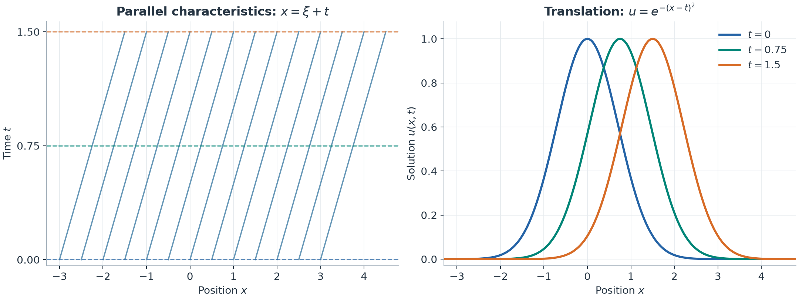
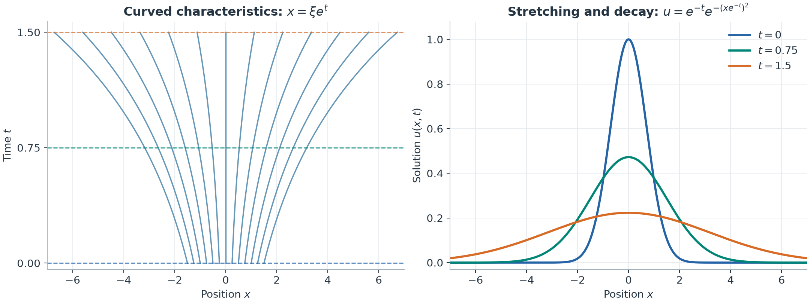
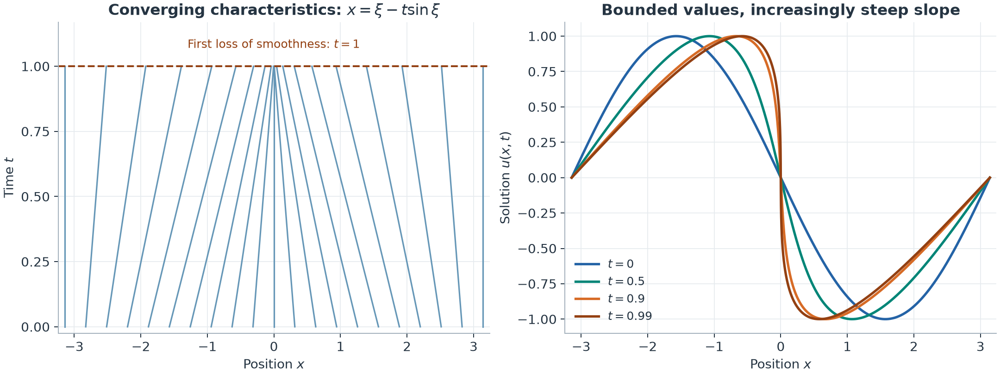

In [What Is a PDE?](../2026-07-18-what-is-a-pde/index.qmd), we checked whether a given function satisfied a partial differential equation. However, we left a key question open -- how do we FIND said function that satisfies
a given PDE? This is a question I aim to demystify in my analytical series here, starting with first-order PDEs.

For an important class of first-order PDEs, the starting point is something you may recall from Calc I: the chain rule. If we follow the right curves through space and time, the PDE becomes a system of ordinary differential equations. This is the **method of characteristics**.

We will use it to solve two transport problems explicitly, then explore a nonlinear example where a smooth initial profile develops an infinite slope. To fully appreciate the work, I advise you to be familiar with partial derivatives, the chain rule, and basic ODEs such as $X'=c$ and $X'=X$.

## Start with a moving profile

Imagine a temperature pattern carried along a straight pipe at a constant speed $c$, with diffusion and heat exchange neglected. If $u(x,t)$ is the temperature at position $x$ and time $t$, a simple model is

$$
u_t+c u_x=0,\qquad x\in\mathbb{R},\quad t\geq 0.
$$ {#eq-transport}

This equation is **first order** because its highest derivatives are $u_t$ and $u_x$. To specify the initial temperature pattern, we also prescribe

$$
u(x,0)=f(x).
$$

Here $f$ is a known, continuously differentiable function. We use the entire real line so that there are no spatial boundaries to handle yet.

The equation tells us how spatial variation and temporal change are related. At a fixed position, the temperature may change as the pattern passes. But what would someone moving with the pattern measure?

### Follow a curve and apply the chain rule

Let $X(t)$ be the position of a moving observer. The value they measure is

$$
U(t)=u(X(t),t).
$$

Unlike $u$, which depends on two variables, $U$ depends only on time. The chain rule gives

$$
\frac{dU}{dt}
=u_x(X(t),t)\frac{dX}{dt}+u_t(X(t),t).
$$

If we choose $X'(t)=c$, the right-hand side is precisely the left-hand side of @eq-transport. Therefore,

$$
\frac{dX}{dt}=c,\qquad \frac{dU}{dt}=0.
$$

We have turned the PDE into two ODEs! The second equation says that the value stays constant along the chosen path. These paths in the $(x,t)$ plane are called **characteristics**.

### Use the initial data

Label each path by its starting position $\xi$ (the Greek letter xi). Then

$$
X(0)=\xi,\qquad U(0)=f(\xi).
$$

Integrating the ODEs gives

$$
X(t)=\xi+ct,\qquad U(t)=f(\xi).
$$

To find the solution at a particular point $(x,t)$, identify which characteristic reaches it. Solving $x=\xi+ct$ gives $\xi=x-ct$, and hence

$$
\boxed{u(x,t)=f(x-ct).}
$$ {#eq-transport-solution}

The value at $(x,t)$ is the initial value at $x-ct$. For $c>0$, the profile moves to the right; for $c<0$, it moves to the left. Its shape and amplitude stay the same.

For example, with $c=1$ and $f(x)=e^{-x^2}$,

$$
u(x,t)=e^{-(x-t)^2}.
$$

The peak starts at $x=0$ and moves along $x=t$.

{#fig-transport fig-alt="Left: parallel characteristic lines in the space-time plane. Right: Gaussian profiles at times zero, 0.75, and 1.5, with their peaks moving right at unit speed."}

### Check the answer

An explicit formula is easy to verify:

$$
u_t=-c f'(x-ct),\qquad u_x=f'(x-ct).
$$

Thus $u_t+c u_x=0$, and at $t=0$ we recover $u(x,0)=f(x)$. Both the PDE and the initial condition hold.

## A general recipe

The same calculation works for equations of the form

$$
u_t+a(x,t,u)u_x=b(x,t,u).
$$ {#eq-quasilinear}

This is a **quasilinear** first-order equation: the first derivatives appear linearly, but their coefficients may depend on $u$. Linear transport is a special case. A fully nonlinear equation such as $u_t+(u_x)^2=0$ needs an extended characteristic system, which we will leave for another post.

Writing $X=X(\xi,t)$ and $U=U(\xi,t)$ to show the starting-point label explicitly, the characteristic equations are

$$
\boxed{
\begin{aligned}
\frac{dX}{dt}&=a(X,t,U), & X(\xi,0)&=\xi,\\
\frac{dU}{dt}&=b(X,t,U), & U(\xi,0)&=f(\xi).
\end{aligned}}
$$ {#eq-characteristics}

Each derivative here is taken with $\xi$ fixed. The first ODE determines the path; the second determines how the value changes along it. In particular, **the value is constant along a characteristic when $b(X,t,U)=0$ all along that path**.

The practical steps are:

1. Solve the characteristic ODEs using the initial data.
2. Solve $X(\xi,t)=x$ for the starting label $\xi$, if possible.
3. Substitute that label into $U(\xi,t)$ to recover $u(x,t)$.
4. Check the PDE, the data, and the region where the construction is valid.

This same general framework is developed in @stanfordcharacteristics and is explained in further detail there.

## Variable speed and a changing amplitude

Now consider, in dimensionless variables,

$$
u_t+xu_x=-u,\qquad u(x,0)=f(x).
$$ {#eq-variable-transport}

Two things have changed: the transport speed is now $x$, and the right-hand side makes the value decay along a moving path. The characteristic equations become

$$
\frac{dX}{dt}=X,\qquad \frac{dU}{dt}=-U.
$$

Using $X(0)=\xi$ and $U(0)=f(\xi)$ gives

$$
X(\xi,t)=\xi e^t,\qquad U(\xi,t)=e^{-t}f(\xi).
$$

This also includes $\xi=0$, whose characteristic remains at $x=0$. For any finite $t$, we can invert the position formula:

$$
\xi=xe^{-t}.
$$

Consequently,

$$
\boxed{u(x,t)=e^{-t}f(xe^{-t}).}
$$ {#eq-variable-solution}

With the same initial Gaussian $f(x)=e^{-x^2}$, this becomes

$$
u(x,t)=e^{-t}\exp\!\left(-x^2e^{-2t}\right).
$$

The profile spreads because points farther from the origin move faster, while its peak decreases by the factor $e^{-t}$. The two effects come from different characteristic equations.

{#fig-variable-transport fig-alt="Left: curved characteristics spreading away from the stationary path at x equals zero. Right: Gaussian profiles that become wider and lower as time increases."}

To verify the formula, abbreviate $\eta=xe^{-t}$. Then

$$
\begin{aligned}
u_t&=-e^{-t}f(\eta)-e^{-t}\eta f'(\eta),\\
xu_x&=e^{-t}\eta f'(\eta).
\end{aligned}
$$

Adding cancels the terms involving $f'$, leaving $u_t+xu_x=-u$. At $t=0$, the solution again equals $f(x)$.

Variable coefficients and source terms change the ODEs, but the underlying chain-rule argument survives. For further worked examples of these variations, see @ivriifirstorder.

## When the solution determines its own speed

The **inviscid Burgers equation** is

$$
u_t+u u_x=0,\qquad u(x,0)=f(x).
$$ {#eq-burgers}

It resembles constant-speed transport, but now $u$ itself is the transport speed. The characteristic equations are coupled:

$$
\frac{dX}{dt}=U,\qquad \frac{dU}{dt}=0.
$$

The second equation still gives $U(\xi,t)=f(\xi)$. That makes the speed along each path constant, so

$$
\boxed{X(\xi,t)=\xi+t f(\xi),\qquad U(\xi,t)=f(\xi).}
$$ {#eq-burgers-parametric}

Each characteristic is a straight line, but different starting values produce different speeds. The lines need not be parallel.

To express the answer in terms of $x$ and $t$, we must solve

$$
x=\xi+t f(\xi).
$$

Even if we cannot isolate $\xi$ using elementary functions, @eq-burgers-parametric is an exact parametric description. Equivalently, wherever the characteristic map is invertible,

$$
u(x,t)=f\bigl(x-tu(x,t)\bigr).
$$

This is an **implicit** solution: the unknown appears on both sides. Solving a PDE analytically can produce a useful exact relation without producing an explicit elementary formula.

### A smooth profile that becomes infinitely steep

Take

$$
f(x)=-\sin x.
$$

Then

$$
x=\xi-t\sin\xi,\qquad u(x,t)=-\sin\xi.
$$

Near the origin, values to the left are positive and move right; values to the right are negative and move left. The profile compresses. We can find exactly when smoothness fails by differentiating the position map:

$$
\frac{\partial X}{\partial\xi}=1-t\cos\xi.
$$

For $0\leq t<1$, this derivative is at least $1-t>0$. Moreover, $X(\xi,t)-\xi$ is bounded, so $X$ ranges over the whole real line as $\xi$ does. Thus every $x$ has exactly one starting label, and the formula defines a smooth solution.

To see what happens to the slope, differentiate $u(X(\xi,t),t)=f(\xi)$ with respect to $\xi$:

$$
u_x(X(\xi,t),t)\,X_\xi(\xi,t)=f'(\xi).
$$

For general smooth data, this gives

$$
u_x(X(\xi,t),t)=\frac{f'(\xi)}{1+t f'(\xi)}.
$$ {#eq-burgers-slope}

For our sine profile, the characteristic starting at $\xi=0$ stays at $x=0$, and

$$
u_x(0,t)=-\frac{1}{1-t}\longrightarrow-\infty
\qquad\text{as }t\to1^-.
$$

The amplitude remains bounded by $1$, but the slope becomes unbounded. The classical solution therefore breaks down at $t=1$.

{#fig-burgers fig-alt="Left: nonparallel straight characteristics converging near the origin, with the first gradient blow-up time t equals one marked by a dashed line. Right: initially sinusoidal profiles developing an increasingly steep central slope at times zero, 0.5, 0.9, and 0.99."}

At $t=1$, the characteristic map loses its differentiable inverse at the origin. For $t>1$, it folds and assigns multiple values to some positions. That folded construction is no longer a classical solution $u(x,t)$.

Continuing beyond this point requires a broader notion of solution. In conservation form,

$$
u_t+\left(\frac{u^2}{2}\right)_x=0,
$$

Burgers' equation admits weak solutions containing shocks. An entropy condition selects the physically relevant continuation. That is a separate topic; @clawpackburgers develops the shock and entropy picture in detail.

## Why the location of the data matters

So far, we have supplied data along $t=0$. Each characteristic starts at one point on that line, allowing us to assign a value to every path.

Suppose instead that, for constant-speed transport, we prescribe

$$
u(ct,t)=g(t).
$$

The curve $x=ct$ is itself a characteristic. Since $u$ must be constant along it, a nonconstant $g$ is incompatible with the PDE. If $g(t)=K$ is constant, it fixes only the value on that one path. Every solution $u(x,t)=F(x-ct)$ with $F(0)=K$ satisfies those data, so the neighboring values remain undetermined.

This is why we look for **noncharacteristic data**: the curve carrying the data should cross the characteristic direction rather than run tangent to it.

::: {.callout-note collapse="true" title="Optional detail: the noncharacteristic condition"}

For

$$
A(x,t,u)u_x+B(x,t,u)u_t=C(x,t,u),
$$

suppose data $u=g(r)$ are prescribed along $(x_0(r),t_0(r))$. The characteristic direction in the $(x,t)$ plane is $(A,B)$. The noncharacteristic condition is

$$
x_0'(r)B-t_0'(r)A\neq0,
$$

with $A$ and $B$ evaluated at $(x_0(r),t_0(r),g(r))$. This determinant says that the data curve and the characteristic direction are linearly independent. Under suitable smoothness assumptions, it permits a local characteristic construction; it does not guarantee a smooth solution for all time [@stanfordcharacteristics].

For @eq-quasilinear with data on $t=0$, we have $A=a$, $B=1$, $x_0(r)=r$, and $t_0(r)=0$, so the determinant is $1$.

:::

On a bounded interval, the same geometry tells us which boundary data are needed. For $u_t+c u_x=0$ on $0<x<L$ with $c>0$, characteristics enter through $x=0$. We prescribe inflow data there as well as the initial profile; the value at $x=L$ is determined by the solution. For a classical solution, initial and boundary data must agree appropriately where they meet.

## What characteristics give us

The method works by finding paths along which partial derivatives combine into an ordinary derivative. Initial data label those paths, and solving the ODEs tells us how both position and solution value evolve.

There are two checks to keep in view: the ODE solutions must continue to exist, and their characteristic map must remain invertible with enough regularity. The linear examples passed both checks for every finite forward time. The Burgers example failed the second at $t=1$.

For scientific computing, these analytical solutions also provide useful benchmarks. A numerical transport method should reproduce the direction, speed, and shape of a translated profile. For Burgers' equation, it should capture steepening before the classical solution breaks down. Having an exact solution makes those comparisons much more informative.

The figures evaluate the derived formulas directly; they do not use a numerical PDE solver. Their source is available in [plot_characteristics.py](plot_characteristics.py).

## References

::: {#refs}
:::
